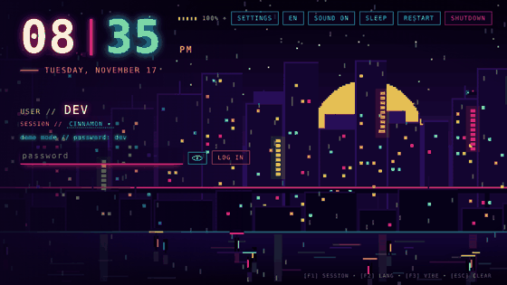
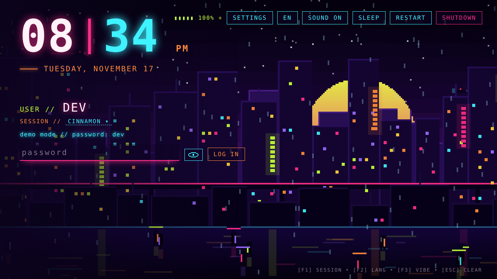
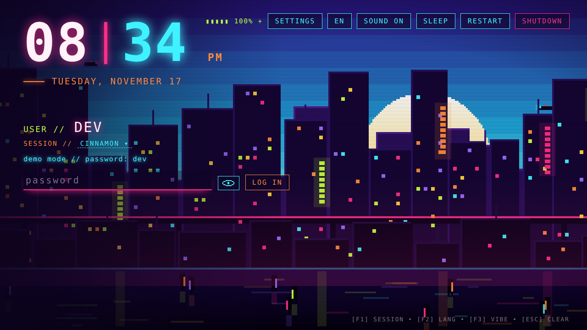
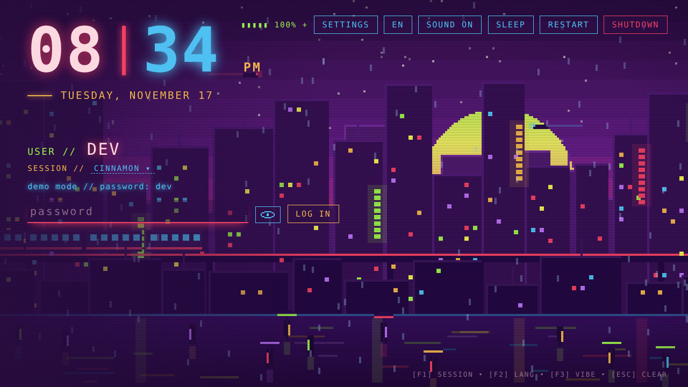
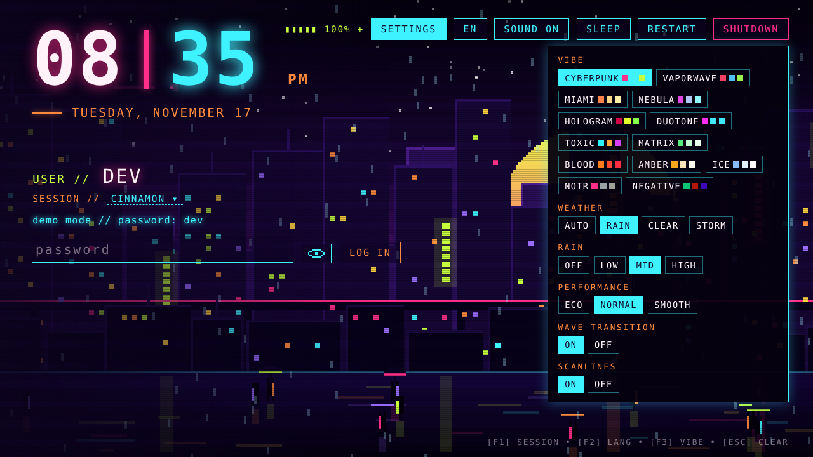

# weirdlock



Animated cyberpunk pixel-art theme for [web-greeter](https://github.com/JezerM/web-greeter) (LightDM). The city, rain, walkers, flying cars and the train are all drawn in code, no image assets needed.

| Night | Day | Storm |
|---|---|---|
|  |  |  |

Settings panel:



## Install
```bash
git clone https://github.com/ziad144/weirdlock
cd weirdlock
sudo bash install.sh
```
The script prepares the theme in a temporary folder and swaps it in, so a failed copy never leaves you without a theme. It keeps the previous version as `weirdlock.old`, backs up `/etc/lightdm/web-greeter.yml` once and sets `theme: weirdlock`. Test with `web-greeter --debug`.

Manual install: copy the folder to `/usr/share/web-greeter/themes/` and set `theme: weirdlock` under `greeter:` in `/etc/lightdm/web-greeter.yml`.

| Distro | web-greeter |
|---|---|
| Linux Mint / Ubuntu | install from the web-greeter releases page |
| Arch | `yay -S web-greeter` |
| Others | see the web-greeter project page |

Enable the greeter with a drop-in file, so Mint's own config stays untouched:
```bash
sudo bash install.sh --enable
sudo systemctl restart lightdm   # closes your session, LightDM only reads its config at start
```
Logging out is not enough, LightDM reads `lightdm.conf.d` once when it starts.

Remove everything and restore the config backup:
```bash
sudo bash uninstall.sh
sudo systemctl restart lightdm
```
If the screen is stuck, press `Ctrl+Alt+F2`, log in and run the uninstall from there.

To use it as a lock screen, bind `dm-tool lock` to a keyboard shortcut.

## Troubleshooting
- Black screen and `KeyError: 'secondary_html'` in `/var/log/lightdm/seat0-greeter.log`: `index.yml` must contain both `primary_html` and `secondary_html`.
- An "error occurred" dialog, or the default gruvbox theme showing instead: web-greeter detected a JavaScript error in the theme and offered its fallback. Run `web-greeter --debug` and read the console.
- If you set `background` in `config.js`, make sure the file exists. A missing file is logged as a JavaScript error and web-greeter may fall back to its default theme. Keep web-greeter's theme error detection enabled, it is the safety net.
- `Unable to determine socket to daemon` in `--debug` is normal when you run it inside a desktop session, you can only preview, not log in.

## Features
- Sky follows the clock (dawn, day, dusk, night) and weather is picked at random: rain, clear night with a blimp and neon fog, or a storm with lightning and thunder
- Mouse parallax over four city layers
- User photo in a neon frame, shown as is
- Username decode animation on open
- 13 vibes (cyberpunk, vaporwave, miami, nebula, hologram, duotone, toxic, matrix, blood, amber, ice, noir, negative), switched with a circular wave that spreads from the center (drawn on the low-res canvas, so it stays cheap), remembers the last one
- Session menu listing every installed session, remembers the last one used
- Handles any PAM prompt: password, 2FA code, fingerprint messages
- EN/AR toggle that types Arabic in the password field, even if the system layout is English only
- Caps lock warning, battery bar, square password mask, show/hide password button
- Typing sounds with a mute button
- Settings panel (`settings` button, top right): vibe, weather, rain amount, performance (eco 15 fps, normal 30, smooth 60), wave transition, scanlines, glitch, parallax, sound, 12/24h clock, idle dim, reset. Everything is remembered
- RGB glitch on wrong password, `ACCESS GRANTED` flash on success
- Idle mode: the UI fades and the city keeps running as a screensaver
- Click the sun for acid rain

## Keys
`F1` next session, `F2` or `Alt+Shift` toggle EN/AR, `F3` next vibe, `Esc` close the menu or clear the field (press again to idle).

## Customize
Edit `config.js`.

| Key | Default | |
|---|---|---|
| `clock24` | `false` | 12 or 24 hour clock |
| `locale` | `'en-US'` | date and AM/PM language, `'ar-EG'` for Arabic |
| `sky` | `'auto'` | `night`, `dawn`, `day`, `dusk` |
| `weather` | `'auto'` | `rain`, `clear`, `storm` |
| `vibe` | `'cyber'` | default vibe: `cyber`, `vapor`, `miami`, `nebula`, `holo`, `duo`, `toxic`, `matrix`, `blood`, `amber`, `ice`, `noir`, `negative` |
| `scan`, `transition` | `true` | scanlines and the wave transition |
| `tagline` | `''` | small line under the date |
| `idle` | `30` | seconds before idle mode, `0` disables |
| `primaryOnly` | `false` | show the login only on the monitor at 0,0 |
| `background` | `''` | image or gif that replaces the city |
| `rainDrops`, `parallax`, `parallaxStrength`, `fps`, `glitch`, `sound` | | |

Set `background: 'bg.gif'` in `config.js` (any image or gif next to `index.html`) to replace the city, the rain stays.

## Preview
Open `index.html` in a browser. It runs with a mock user, type `dev` as the password to see the unlock animation.

## License
MIT
